<!--
  github.com/kaandgnsh — profile README
  ─────────────────────────────────────
  assets/*.svg          static artwork, built by scripts/build_assets.py
                        (edit the CONTENT block in that file, then re-run it)
  output branch         live telemetry + snake, rebuilt daily by
                        .github/workflows/profile-assets.yml
  new contact button    add a line to CHANNELS in build_assets.py, re-run,
                        then copy one of the <a> blocks in the Channels section
-->

  

  

  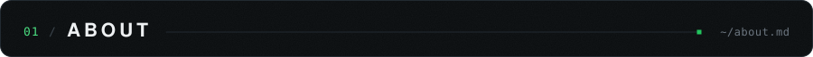

I'm a first-year **Software Engineering** student at OSTİM Technical University in Ankara. I want to understand software and systems from the ground up: how they work, how they break, and how to make them secure.

Right now that means building security tooling in Python, from single-purpose utilities to **Argus**, a modular OSINT framework, all with **safe defaults**. The tools use strict input validation, ask for explicit consent before touching a system, and run unit tests in CI. Alongside that, I'm training in penetration testing, web security, and system & network security.

**Long-term goal:** cybersecurity specialist with solid engineering fundamentals.

  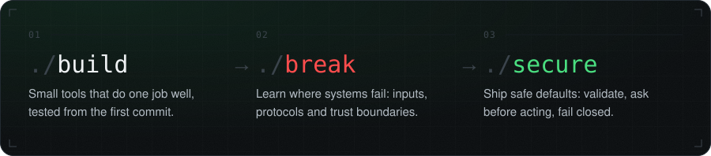

  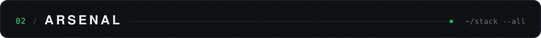

  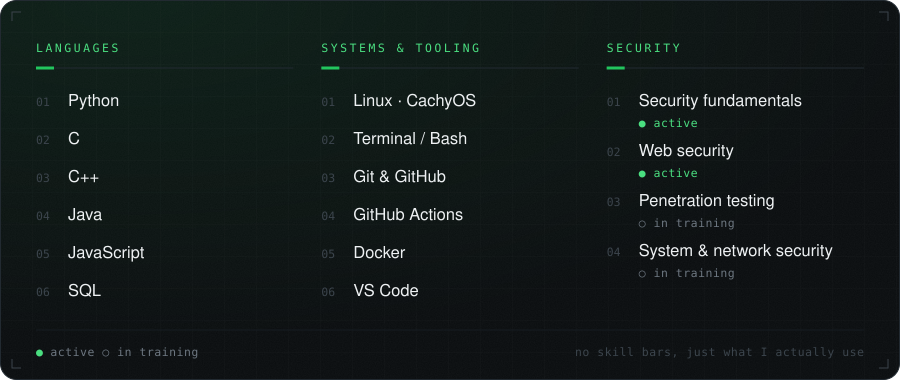

  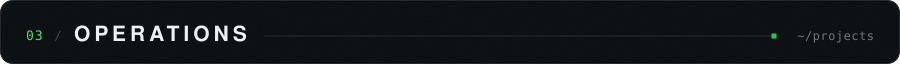

  <a href="https://github.com/kaandgnsh/Argus"></a>

  <a href="https://github.com/kaandgnsh/m-dos">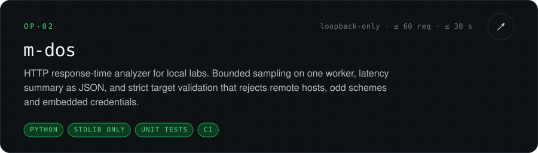</a>

  <a href="https://github.com/kaandgnsh/hider">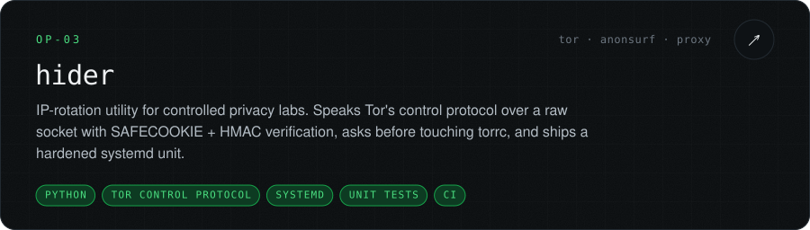</a>

  <a href="https://github.com/kaandgnsh/all-pip-installer">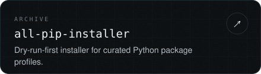</a>
  <a href="https://github.com/kaandgnsh/m-info-get">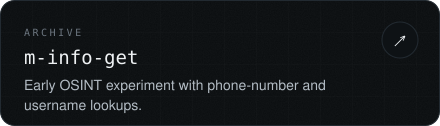</a>

  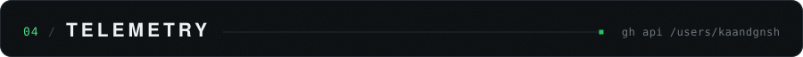

  

  

  <picture>
    <source media="(prefers-color-scheme: dark)" srcset="https://raw.githubusercontent.com/kaandgnsh/kaandgnsh/output/snake-dark.svg">
    <source media="(prefers-color-scheme: light)" srcset="https://raw.githubusercontent.com/kaandgnsh/kaandgnsh/output/snake-light.svg">
    
  </picture>

  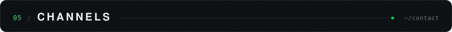

  <a href="mailto:dogankaan217@gmail.com">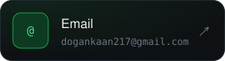</a>
  <a href="https://www.linkedin.com/in/kaan-do%C4%9Fan-911663280/">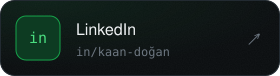</a>
  <a href="https://instagram.com/kaandgn.sh">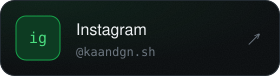</a>

  
  <!-- fallback counter: https://komarev.com/ghpvc/?username=kaandgnsh&label=visitors&color=16a34a&style=flat-square -->

  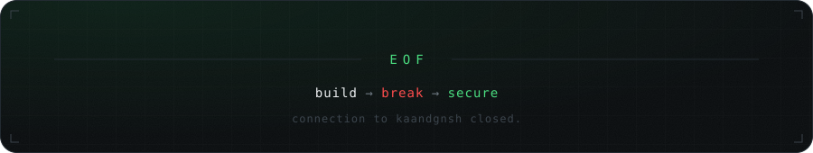

